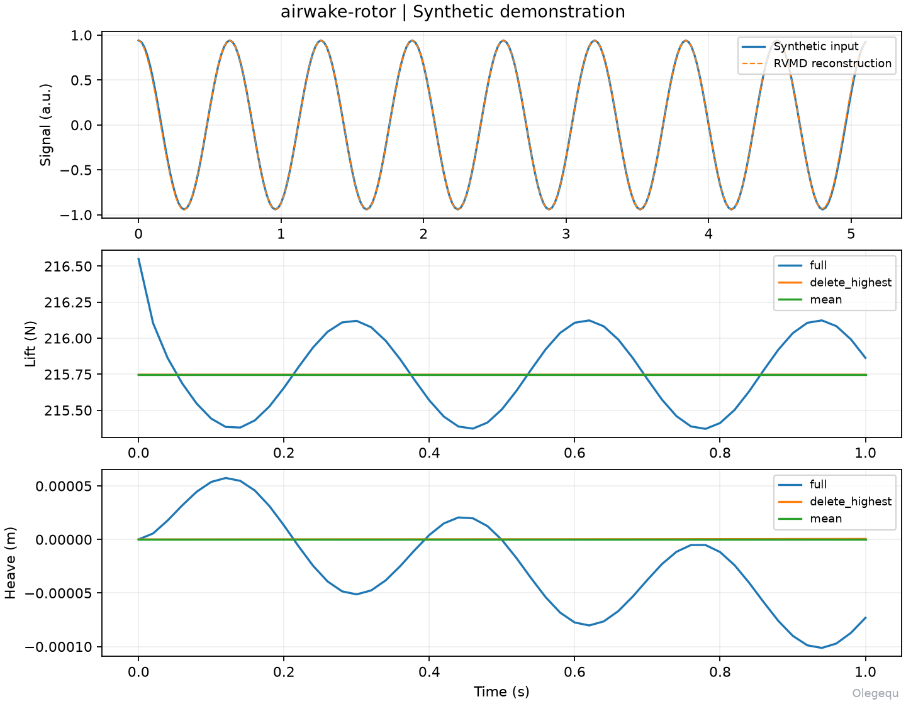

# airwake-rotor

**甲板尾流模态分解与旋翼非线性动力学 · Olegequ**

[English](README.md) · [完整运行流程](docs/workflow.md) · [模型适用范围](docs/model_assumptions.md)

本项目将现有科研代码封装为可安装的 `airwake_rotor` Python 包。主要功能包括：

- 三维 CSV 流场校验、可恢复缓存及严格的时空边界检查；
- CountSketch/POD 压缩、实值 RVMD、全空间回归和重构残差能量审核；
- 非线性叶素、近悬停三状态 Pitt–Peters 动态入流及滚转、俯仰、升沉响应；
- 高频累计删模、单模态、留一模态敏感性及 St90 分析；
- DMD 物理模态分组、统计、绘图和计算溯源检查。

## 安装与示例

需要 Python 3.10–3.12。在项目根目录创建并激活虚拟环境，然后运行：

```powershell
python -m venv .venv
.venv\Scripts\Activate.ps1
python -m pip install -e ".[dev]"
airwake-rotor --version
airwake-rotor demo --output runs/demo
python -m pytest
```

Linux/macOS 使用 `source .venv/bin/activate` 激活环境。
也可以使用 `python -m airwake_rotor` 调用命令。

合成示例不需要原始 CFD 数据或显卡：它生成两个已知频率，执行 RVMD、合成旋翼
悬停配平，并将全模态、删除最高频模态和纯均值三种流场输入相同的非线性耦合模型。
输出位于 `runs/demo`，包含 CSV、NPZ、JSON 和带 `Olegequ` 水印的示例图。
该示例用于验证安装与计算链路，不代表真实航空器验证结果。



## 使用自己的数据

原始流场、历史结果、论文及专利材料均不随本仓库分发。请阅读
[运行流程](docs/workflow.md)，按约定准备逐帧 CSV，并修改配置中的数据目录、
采样间隔、帧编号、轮毂坐标和候选模态数。

`config/nato_gd_rvmd_3d.json` 保留研究模板中的物理约定和门槛。轮毂坐标为占位值，
状态设为待确认；不能直接作为正式工况运行。完整研究层目前强制参考尺度
`Lref=13.716 m`、`Uref=20 m/s`，其他研究需要修改并验证该层。
型号参数含工程估计，理想悬停保持器未建模执行机饱和，完整限制见
[模型说明](docs/model_assumptions.md)。

## 作者标识与许可

项目署名为 **Olegequ**，用于代码文件头、包元数据、命令行版本和主要绘图输出。
水印仅在导出图件时添加，不改变数值数据。原方法与第三方版权声明予以保留。

项目采用 [MIT 许可证](LICENSE)，RVMD 原作者的许可证另见
[第三方声明](THIRD_PARTY_NOTICES.md)。
本地发布及 GitHub 上传步骤见 [发布指南](docs/publishing.md)。
